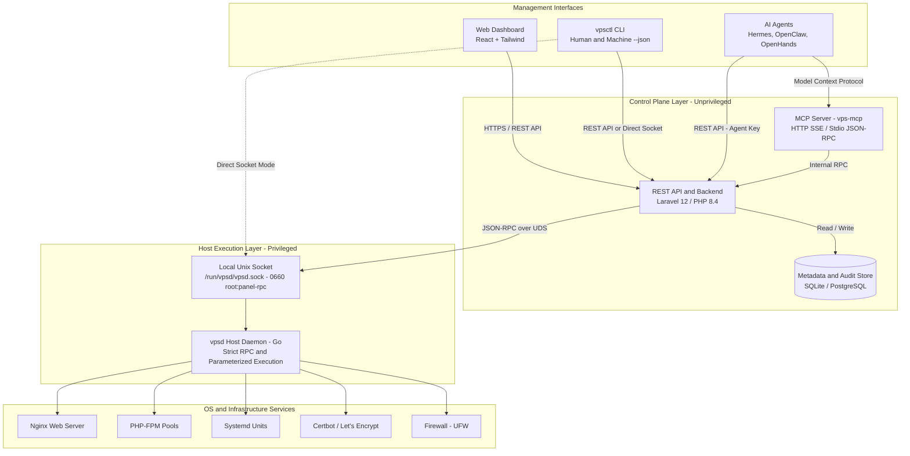

# AI-Native VPS Management Panel

A lightweight, secure, and extensible self-hosted VPS control panel designed to simplify server administration, website hosting, zero-downtime application deployments, and **AI Agent integration** (Hermes Agent, OpenClaw, OpenHands, and custom agents).

```text
Product Philosophy: AI-Native Infrastructure Management
Let humans and AI agents manage infrastructure through one unified control plane.
```

---

## Architecture Overview



---

## Core Capabilities

1. **Privilege Separation**: The web application runs as unprivileged `www-data` and **never** executes shell commands as root. All host mutations are handled by `vpsd` over an authenticated Unix Domain Socket (`/run/vpsd/vpsd.sock`).
2. **Atomic Zero-Downtime Releases**: Deploys applications using timestamped release directories (`releases/<timestamp>`) and atomic POSIX symlink swaps (`current -> releases/<timestamp>`), with instant single-command rollback.
3. **Model Context Protocol (MCP) Server**: Provides native tool discovery and execution for autonomous AI agents (`vps-mcp`), supporting both stdio and HTTP/SSE transports.
4. **Human-in-the-Loop Safety Gate**: Sensitive operations initiated by AI agents (`project.delete`, `server.reboot`, `firewall.modify`) are automatically intercepted and require administrative confirmation.
5. **Unified CLI (`vpsctl`)**: Formatted color tables for humans and strict `--json` output for automation and AI agents.

---

## Quick Start (Ubuntu 22.04 LTS / 24.04 LTS)

### 1. One-Line Automated Installer
```bash
sudo ./scripts/install.sh
```

### 2. Basic CLI Commands
```bash
# Check server resources
vpsctl server resources

# Output machine-readable JSON
vpsctl server resources --json

# List hosted projects
vpsctl project list

# Create a new project
vpsctl project create my-app app.example.com laravel

# Update project from Git repository (zero-downtime atomic release)
vpsctl project update my-app

# Check or update VPS Panel itself from git repository
vpsctl server update --check
vpsctl update

# Issue Let's Encrypt SSL
vpsctl ssl install app.example.com

# Roll back a project
vpsctl project rollback my-app
```

---

## Repository Structure

```text
panel-cli/
├── daemon/                 # vpsd: Privileged Go execution daemon
│   ├── cmd/vpsd/           # Daemon entrypoint
│   └── internal/           # Nginx, SSL, deploy, systemd, firewall controllers
├── cli/                    # vpsctl: Unified Command Line Interface
│   └── cmd/vpsctl/         # Interactive & JSON-ready CLI commands
├── mcp/                    # vps-mcp: Model Context Protocol Server (stdio & SSE)
├── pkg/                    # Shared Go protocol, client, and metrics packages
├── backend/                # Control Plane Backend (Laravel 12 / PHP 8.4)
│   ├── app/                # Controllers, Models, Middleware, VpsDaemonService
│   ├── database/           # Migrations & Seeders
│   └── routes/             # REST API v1 endpoints
├── frontend/               # Web Dashboard (React + TypeScript + Tailwind CSS)
│   ├── src/components/     # Sidebar, Header, and Modular Views
│   └── dist/               # Compiled production assets
├── scripts/                # Automated installer & systemd unit templates
└── docs/                   # Setup, Hermes, OpenClaw, and Security documentation
```

---

## Documentation

- [Ubuntu Setup Guide](file:///Users/youngpreneur/SERVER FILE/KODEPRENEUR/panel-cli/docs/UBUNTU_SETUP.md)
- [Hermes Agent Integration](file:///Users/youngpreneur/SERVER FILE/KODEPRENEUR/panel-cli/docs/HERMES_AGENT.md)
- [OpenClaw Integration](file:///Users/youngpreneur/SERVER FILE/KODEPRENEUR/panel-cli/docs/OPENCLAW.md)
- [Security Architecture](file:///Users/youngpreneur/SERVER FILE/KODEPRENEUR/panel-cli/docs/SECURITY.md)
- [REST API Reference](file:///Users/youngpreneur/SERVER FILE/KODEPRENEUR/panel-cli/docs/API_REFERENCE.md)

